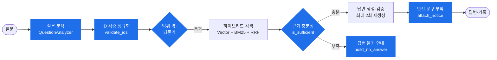

# MANSA

**Manual & Safety Assistant — 매뉴얼을 물으면 안전이 따라옵니다**

설비 매뉴얼과 안전 기준을 근거로 답하는 RAG 기반 기술 질의응답 서비스

 

[원본 저장소](https://github.com/HYUNDAI-AI-team6/mansa) · [팀 README](TEAM_README.md)

 

 

## Overview

| | |
| --- | --- |
| **프로젝트** | 현대 AI 인사이트 캠퍼스 6팀 1차 프로젝트 |
| **기간** | 2026.10 ~ 2026.11.02 (최종 발표) |
| **인원** | 6명 |
| **나의 역할** | **팀장** · 질의응답(L2) 파이프라인 · LLM 공통 모듈 · 발표 자료 · 결과보고서 |

현장 엔지니어가 설비 매뉴얼과 안전 기준을 따로 찾지 않고, **질문 하나로 작업 절차·사양 수치·안전 요건을 출처와 함께** 확인하도록 돕는 서비스입니다.

- 매뉴얼과 안전 문서를 함께 검색해 답을 한 화면에 보여 줍니다.
- 답변마다 근거 문서와 원문을 함께 보여 주고, 안전 요건에는 안전관리자 확인 문구를 붙입니다.
- 모호한 질문은 되묻고, 문서에 없는 질문은 답변 불가로 안내합니다.

 

## My Role

### 팀장

- 일정 관리, 역할 분배, 회의 진행
- PR 리뷰·머지, 팀원 간 데이터 구조·인터페이스 합의 조율

### 산출물

- **발표 자료(PPT)** 전체 제작
- **결과보고서** 작성

### 개발 — 질의응답(L2) 핵심 흐름

질문이 들어와서 답이 나가기까지의 **처리 순서와 공통 데이터 구조**를 설계하고, 질문 분석·안전 문서 검색·LLM 호출 모듈을 구현했습니다.

> 파란색이 직접 구현한 단계이며, 전체 순서 조율(`QAService.answer`)과 공통 스키마도 담당했습니다.
> 검색 단계는 안전 문서 검색(`search_safety`)을, 답변 생성은 LLM 호출 함수(`complete`)를 구현했습니다.

 

## Key Implementations

### 1. QA 파이프라인 설계 — 팀의 기준이 되는 뼈대 먼저 만들기

**문제** 질문 분석·검색·답변 생성을 각각 다른 팀원이 맡아, 서로 주고받는 데이터 형식이 정해지지 않으면 연결 단계에서 충돌이 예상됐습니다.

**해결**
- 공통 데이터 구조 `Intent`, `ScoredChunk`, `Evidence`, `Answer`, `Clarify`, `NoAnswer` 등을 먼저 정의
- 단계별 입출력을 `Protocol`로 정해 각 팀원이 독립적으로 구현하고 생성자로 주입
- LLM·DB 없이 동작하는 부분(근거 병합, 충분성 판단, 답변 불가 안내, 안전 문구)을 먼저 구현하고 단위 테스트 21개로 흐름 검증

### 2. 안전 문서 하이브리드 검색

**문제** 벡터 검색만으로는 "메인 로프", "트랙션 머신"처럼 정확한 용어가 중요한 안전 문서를 놓칠 수 있습니다.

**해결**
- 질문에 작업 부위·작업 내용을 덧붙여 검색어 보강
- 벡터 검색과 BM25 단어 검색을 각각 상위 20개씩 수행
- RRF(Reciprocal Rank Fusion)로 두 순위를 합쳐 최종 순서 결정
- 외부 호출 함수를 인자로 받아 네트워크 없이 테스트 가능하게 설계

### 3. LLM 공통 모듈 `core.llm`

**`complete` — 구조화 응답과 재시도 정책**
- `with_structured_output`으로 Pydantic 형식의 JSON만 받아 `dict`로 반환
- 형식 오류·길이 잘림·시간 초과만 정해진 횟수까지 재시도, 초과 시 원인을 보존한 `LlmError`
- LLM 거부는 즉시 실패, 인증 오류는 재시도 없이 전달
- SDK 자체 재시도를 꺼서 재시도 횟수를 정확히 제어

**`embed` — 임베딩**
- 임베딩 모델을 생성형 모델과 분리 설정 (`text-embedding-3-large`, 3072차원)
- 모델 변경 시 기존 컬렉션(1536차원)과의 차원 불일치 문제를 사전에 파악해 재적재 일정을 팀과 조율

### 4. 질문 분석기 `QuestionAnalyzer`

**문제** LLM이 질문에서 뽑은 설비 모델·부위·작업 이름이 등록된 기준정보와 다르면 검색이 틀어집니다.

**해결**
- L2 프롬프트에 등록된 모델·부위·작업 목록을 넣어 그 안에서 고르게 하고, 질문 원문은 지시가 아닌 데이터로 취급 (프롬프트 인젝션 방지)
- 대화의 첫 질문이면 같은 호출에서 대화 제목도 생성해 LLM 호출 횟수 절감
- `validate_ids`로 LLM 결과를 기준정보와 대조해 없는 값 제거, 동의어는 표준 태그로 변환

**실제 LLM 결과로 찾은 문제와 수정**

| 문제 | 수정 |
| --- | --- |
| LLM이 `[모델 A]`를 `모델 A`로 적어 등록 모델에서 빠짐 | 모델명 비교 시 대괄호 차이 무시 |
| 동의어 사전 때문에 표준 부위 "권상기"가 지워짐 | 이미 표준 이름이면 동의어 변환 생략 |
| 단위만 있는 "m/min"이 수치로 추출됨 | 숫자가 들어 있는 값만 유지 |
| LLM이 부위·작업을 빠뜨림 | 질문 원문에서 분류표 이름을 찾아 보완 |

### 5. 태그 필터 검색 문제 발견

- 관련 부위·작업 청크가 유사도 상위 20개 밖에 있으면 검색에서 빠지는 구조적 문제를 발견해 이슈로 정리
- Chroma `where` 조건으로 태그 안에서 검색하는 방향을 설계·검증했고, 검색 담당 팀원의 PR로 반영

 

## Contributions

| 이슈 | 작업 | PR |
| --- | --- | :---: |
| [#32](https://github.com/HYUNDAI-AI-team6/mansa/issues/32) | 질의응답 핵심 처리 단계 · 공통 스키마 | [#36](https://github.com/HYUNDAI-AI-team6/mansa/pull/36) |
| [#41](https://github.com/HYUNDAI-AI-team6/mansa/issues/41) | 안전 문서 하이브리드 검색 `search_safety` | [#43](https://github.com/HYUNDAI-AI-team6/mansa/pull/43) |
| [#55](https://github.com/HYUNDAI-AI-team6/mansa/issues/55) | `core.llm.embed` 임베딩 함수 | [#57](https://github.com/HYUNDAI-AI-team6/mansa/pull/57) |
| [#71](https://github.com/HYUNDAI-AI-team6/mansa/issues/71) | `core.llm.complete` 구조화 응답·재시도 | [#73](https://github.com/HYUNDAI-AI-team6/mansa/pull/73) |
| [#80](https://github.com/HYUNDAI-AI-team6/mansa/issues/80) | `QuestionAnalyzer.validate_ids` | [#86](https://github.com/HYUNDAI-AI-team6/mansa/pull/86) |
| [#88](https://github.com/HYUNDAI-AI-team6/mansa/issues/88) | `QuestionAnalyzer.analyze` L2 질문 분석 | [#94](https://github.com/HYUNDAI-AI-team6/mansa/pull/94) |
| [#104](https://github.com/HYUNDAI-AI-team6/mansa/issues/104) | 태그 필터 벡터 검색 설계 | 팀원 [#123](https://github.com/HYUNDAI-AI-team6/mansa/pull/123) |

<b>커밋 목록 (8)</b>

 

| 날짜 | 커밋 | 내용 |
| --- | --- | --- |
| 10-27 | [`9b0e438`](https://github.com/HYUNDAI-AI-team6/mansa/commit/9b0e438) | QA 서비스 구현 (근거 병합, 안전 문구 부착) |
| 10-27 | [`0b5a8ae`](https://github.com/HYUNDAI-AI-team6/mansa/commit/0b5a8ae) | 로컬 전용 QA 테스트 파일 정리 |
| 10-27 | [`cacf024`](https://github.com/HYUNDAI-AI-team6/mansa/commit/cacf024) | 검색 모듈 재구성 및 BM25 순위 구현 |
| 10-28 | [`f5745b0`](https://github.com/HYUNDAI-AI-team6/mansa/commit/f5745b0) | 임베딩 모델 설정 및 `embed` 추가 |
| 10-28 | [`eaa5e78`](https://github.com/HYUNDAI-AI-team6/mansa/commit/eaa5e78) | `EMBEDDING_MODEL` 기본값 처리 수정 |
| 10-28 | [`82ba837`](https://github.com/HYUNDAI-AI-team6/mansa/commit/82ba837) | LLM 타임아웃·재시도 설정 및 `complete` 추가 |
| 10-28 | [`b575a5e`](https://github.com/HYUNDAI-AI-team6/mansa/commit/b575a5e) | `QuestionAnalyzer` 의도 검증·정규화 구현 |
| 10-28 | [`68a987a`](https://github.com/HYUNDAI-AI-team6/mansa/commit/68a987a) | `QuestionAnalyzer` 프롬프트·검증 보완 |

 

## Screens

| 고객센터 | 관리자 · 문서 관리 |
| :---: | :---: |
|  |  |

> 화면의 문서·수치(`[모델 A]`, `[값]` 등)는 시연용 예시 데이터입니다.

 

## Team

| 이름 | 담당 |
| :---: | --- |
| **이세림 (팀장)** | 질문 분석 · QAService 처리 순서 · 답변 불가 · 안전 문구 · 안전 문서 검색, LLM 호출 · 임베딩, 발표 자료 · 결과보고서 |
| 류영걸 | MySQL · ChromaDB 연결, 환경 변수, 로그인 · 세션 · 회원 관리, 문서 관리 화면 |
| 박규진 | 관리자 평가, 고객센터 챗봇, 사용자 문서 조회, 태그 필터 검색, 협업 규칙 |
| 장영균 | 문서 추출 · 청킹 · 태그 · 임베딩 검증, DocumentService |
| 박정환 | 화면 전체 틀, 기준정보, 문서 처리 파이프라인 · 업로드 흐름, 기준 차이 비교 |
| 강병훈 | 검색(BM25 · 태그 · RRF) · 답변 생성 · 되묻기 · 질문 기록 · 근거 원문, 기술 Q&A 화면 |

 

프로젝트 전체 설명·실행 방법은 [팀 README](TEAM_README.md)를 참고하세요.

